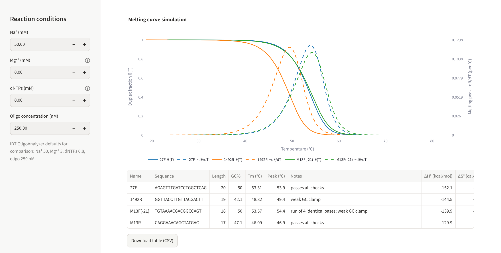

# Primer Melting Curve Simulator

University course project (Python with Biopython). It shows how a PCR primer melts, using only the primer sequence.

Live app: https://biopython-amtknxfcehncwhptsqtnfb.streamlit.app

The free Streamlit app goes to sleep when nobody uses it. If it shows a button to wake it up, press it and wait a minute.



## What it does

You type or paste a primer (or upload a FASTA file) and the app gives you:

- the melting temperature (Tm)
- the melting curve: how much of the primer is still paired at each temperature
- the melting peak (-dθ/dT), which is the curve a qPCR machine shows
- some basic primer checks: GC%, GC clamp, runs of the same base, self-dimer and hairpin

There are four tabs:

1. Analyze primers
2. Scan a template: looks for possible primers in a longer DNA sequence
3. Primer pairs: matches forward and reverse primers with a similar Tm
4. How it works

Na+, Mg2+, dNTPs and primer concentration can be changed in the sidebar.

## How it works (short version)

It uses the nearest-neighbor model with the SantaLucia (1998) numbers, then Tm = ΔH / (ΔS + R ln(C/4)). Sodium changes ΔS. Magnesium uses the Owczarzy (2008) correction, and dNTPs bind some of the Mg2+, so only the free Mg2+ is used. The fraction of primer that is paired at each temperature comes from the equilibrium constant, and the melting peak is the slope of that curve. At Tm exactly half is paired, and the peak sits about 0.5 to 1 °C above Tm. The "How it works" tab in the app explains it a bit more.

## Files

- `app.py`: the Streamlit web page
- `thermo.py`: the maths (Tm, salt corrections, melting curve)
- `primers.py`: reading sequences, primer checks, template scan, pair finder
- `tests/`: the tests
- `requirements.txt`: packages the app needs

## Run it on your computer

```
python -m venv venv
venv\Scripts\activate          (on Mac: source venv/bin/activate)
pip install -r requirements.txt
streamlit run app.py
```

It opens at http://localhost:8501

## Testing

```
python -m unittest discover tests -v
```

This runs 34 tests.

Biopython is only used to check the numbers, it is not inside the app. After `pip install biopython` you can run `python tests/validate_against_biopython.py`. With the same SantaLucia 1998 table, our Tm matched Biopython's to 0.00 °C on 300 random primers.

One primer (GACGTCAGCTAGCTAGCTGATCG) was also compared with IDT OligoAnalyzer: 58.86 °C with no Mg2+ (same as IDT), and 65.87 °C against IDT's 65.8 °C with 3 mM Mg2+ and 0.8 mM dNTPs. Only this one primer was compared with IDT.

## Limits

- Only for perfectly matched primers. No mismatches, no DMSO or formamide.
- The dimer and hairpin checks are simple rules (longest matching stretch), not free-energy calculations like IDT does.
- Templates are limited to 10,000 bases so the app stays fast.

## References

1. SantaLucia J Jr. A unified view of polymer, dumbbell, and oligonucleotide DNA nearest-neighbor thermodynamics. PNAS 1998;95(4):1460-1465.
2. Owczarzy R, et al. Predicting stability of DNA duplexes in solutions containing magnesium and monovalent cations. Biochemistry 2008;47(19):5336-5353.
3. Cock PJA, et al. Biopython: freely available Python tools for computational molecular biology and bioinformatics. Bioinformatics 2009;25(11):1422-1423.

Made by Viswateja.
